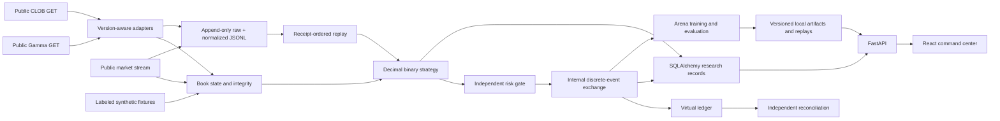

# Architecture

Midas is a modular monolith and a separately built React command center. Financial domain code under `packages/midas` imports neither the API, SQLAlchemy nor frontend. Pydantic is the shared validation contract, not an HTTP response dependency.

## Responsibilities

- `core/models.py`: validated market, fee, instrument, book, event and evaluation contracts.
- `market_data`: public GET allowlist, normalization, bounded reconnecting stream state, raw recording and receipt-ordered replay.
- `arbitrage`: deterministic complete-binary evaluator and a `Strategy` protocol. It knows no portfolio or database.
- `risk`: independently configurable hard constraints over virtual proposals and portfolio exposure. A strategy verdict cannot override them.
- `simulation`: virtual clock, scheduler, exchange, portfolio ledger, accounting auditor, catalog and executable scenarios.
- `apps/api`: configuration, storage, lifecycle orchestration, HTTP contracts and bounded experiment admission.
- `apps/web`: dashboard, scanner inspection, scenario execution, event cursor and persisted analytics.

## Storage and limits

One indexed relational `records` table stores immutable versioned JSON payloads for market metadata, observations, simulations and system events, with source, entity key and receipt time as separate columns. Models are normalized before insertion. Financial values serialize as decimal strings. This reduces migration surface in the first milestone; hot price-level storage and a richer relational experiment schema are deferred.

PostgreSQL uses an Alembic migration. SQLite is the zero-infrastructure offline default and initializes the same initial tables directly. SQLite auto-created schemas should not receive the initial Alembic migration again; use a fresh database for migration exercises. A future schema change must reconcile the SQLite bootstrap with migration history.

Metadata refreshes periodically; the configured active-market subset is sorted by liquidity. Current observations are reevaluated at read time so a stalled refresh cannot retain a verified label. Database records older than the configured retention window are pruned hourly. Raw JSONL files are not deleted automatically: the recorder stops at a configured total budget, reports an error and blocks new audited simulations until storage is restored. Explicit prune tooling is provided.

The websocket queue is bounded at 2,048 frames; deduplication retains 4,096 hashes. In-memory events retain 300 entries. API history queries are bounded. CPU simulation and scanning use worker threads. Two scenario workers are permitted concurrently; total admitted running/queued requests are capped at eight. The virtual clock itself never sleeps.

## Operating boundary

Demo startup constructs no public network client. Live mode observes public data only. Scenario portfolios are always synthetic independent experiments, including while live observation runs. The optional public Data API v2 smoke does not fetch account positions. There is no wallet, secure SDK, signature, external execution adapter, order submission/cancellation route, or credential field.

HTTP endpoints are intended for a trusted local workstation. Docker publishes ports on loopback. Authentication, multi-user access and production ingress are deferred.

## Milestone 2 extension (supersedes the Milestone 1 storage/payout boundary above)

Public Gamma metadata + CLOB fee/delay metadata feed `CTFVerifier`; fixed-contract
finalized Polygon reads produce `MarketEconomicAttestation`. `BinaryStrategy` consumes
the attested structure, records complete/rejected proof traces and conservative live
fee/terminal-rounding bounds. Public REST remains GET-only; RPC POST permits only chain
reads, never transactions. V2 remains economically unsupported in live mode.

The new domain state machine `midas.paper.broker` uses the original strategy/risk,
virtual `Exchange` and independent auditor. `apps.api.paper.PaperBroker` persists a
shared account and immutable journal with an atomic CAS transition. Cash envelopes,
independent leg actions, books, orders, settlements and stop state survive restart.
All startup paths use Alembic 001/002, including recognized legacy SQLite adoption.
SQLite explicitly uses WAL and FULL synchronous writes. Financial tables are never
pruned with observation records. See `RECOVERY_AND_RECONCILIATION.md` for boundaries.

Synthetic, recorded and live-shadow accounts stay separate. New fault/differential
experiments run the production broker state machine. The API and React Paper Trading
page expose the actual durable account. Existing 43 scenarios and their interfaces
remain intact. Historical replay can consume attested metadata and verified settlement
observations; it does not infer missing future observations.

## Project Prometheus extension

Arena research code lives under `packages/midas/arena` and is exposed through the
`/api/arena` routes in `apps/api/arena.py`. It reuses the Laboratory simulator and
accounting checks while keeping datasets, model weights, jobs, tournaments, and replay
payloads in a separate artifact store rooted at `MIDAS_ARENA_ROOT` (default
`data/arena`). Manifests record source and artifact identities; bounded native jobs
capture their source and write durable job state. `apps/web/src/Arena.tsx` presents
those registries and their evaluation evidence.

Arena policies are research artifacts over synthetic scenarios. They do not enter
the live observation or paper-broker decision path. Preserve the distinction between
public observations, synthetic scenarios, modeled execution, and measured findings.
The [Prometheus final report](PROMETHEUS_FINAL_REPORT.md) describes the current
evaluation design and its exceptions.
