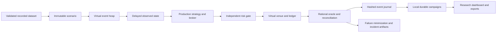

# Laboratory architecture

The Laboratory runs entirely simulated orders through the existing `BinaryStrategy`,
`risk.assess`, paper `transition`, `Exchange`, and ledger reconciliation. Public
recordings are inputs; no execution adapter performs network calls.

`packages/midas/laboratory/clock.py` orders events by `(time, priority, ordinal)`.
Scheduling takes an immutable copy of payloads. IDs are idempotent only with identical
contents. Cancellation is lazy; replacement uses a new ID. Heap checkpoints retain
time, ordinals, queued events, identities and cancellations.

`spec.py` defines frozen Pydantic scenario, cost and event contracts. `runtime.py`
adapts them to production broker commands. Venue books and delayed observed books
are separate. Decision inputs are frozen at observation time; they cannot be updated
by a later event while strategy processing is delayed. Matching uses the modeled
venue state at its own scheduled time. Journals retain before/after portfolios,
observed books, decisions, commands, fault payloads and invariant results.

`oracles.py` uses Fraction and integer rounding without calling production fee,
portfolio or payout helpers. It runs alongside existing reconciliation. Admission
checks additionally inspect approved budgets, edge floors and observation times.
Neither a negative virtual P&L nor uncertain execution is an invariant violation.

`campaigns.py` uses a local SQLite archive with FULL synchronous transactions and WAL.
An OS advisory lock permits one campaign writer per directory; separate readers can
inspect/reproduce results without rewriting statuses. Startup marks abandoned RUNNING
campaigns INTERRUPTED. A bounded spawn-based process pool handles CPU work, including
one-worker campaigns, with Linux address-space limits. Each episode's compared variants
commit atomically. Cancellation/pause finish the in-flight bounded batch; resumption
skips committed episode IDs. Individual environments also support checksummed mid-run
checkpoints. Campaigns currently resume at episode boundaries rather than automatically
serializing every in-flight environment.

Successful runs store compact metrics/config hashes; selected episodes and all failures
retain full journals. Compact runs reconstruct a full journal using archived campaign
inputs, pinned source/dataset hashes and a checked result hash. Detailed results and
journals have separate integrity hashes. Original and minimized failure inputs remain
in the incident artifact. No resolution follows merely from a later passing run.

`apps/api/laboratory.py` exposes catalogs, campaigns, controls, paginated runs,
comparisons, incident summaries, exports and actual re-execution. The existing Incidents
API also includes Laboratory discoveries. `apps/web/src/Laboratory.tsx` adds seven
research tabs while retaining every existing dashboard route and legacy simulation UI.

Logical time never reads wall time. Wall time is used only for resource budgets,
throughput and audit timestamps. Random generators are local and explicitly seeded.
Supported deterministic evidence covers Linux/Python 3.12, different process hash
seeds, one/two workers and checkpoint/resume. Decimal run precision is fixed at 28.
Cross-version Python RNG/serialization changes, code changes, corrupted archives,
changed dataset manifests and externally supplied ordering are explicit reproduction
boundaries. Windows, distributed workers and cross-version archive migrations are
not claimed.

The future-agent interface provides reset, observed state, available actions, step,
reward and termination. Its action set currently advances the deterministic strategy;
custom order-action policies and a formal Gymnasium adapter remain future work.
